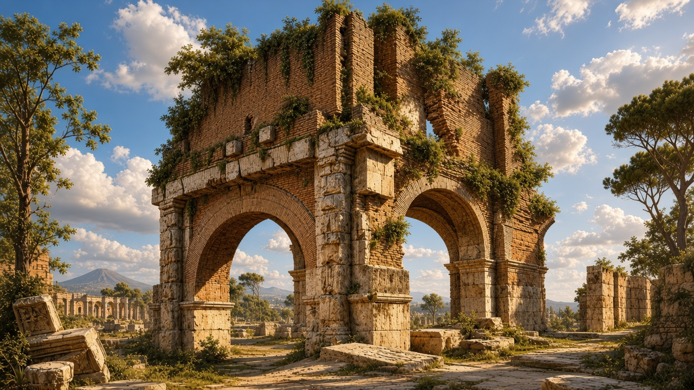
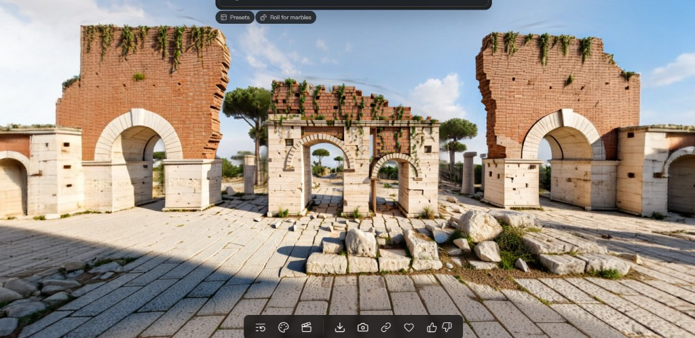
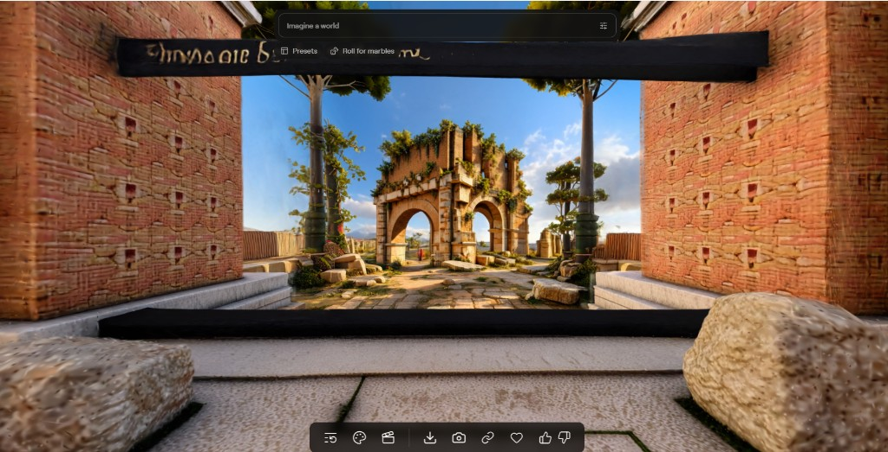
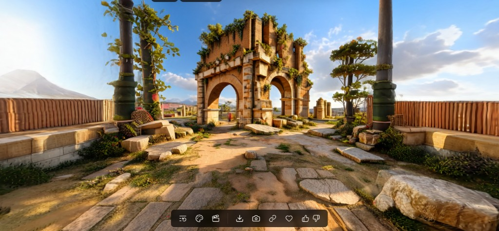

# autonome pipeline

ein youtube-kanal wird zu texten, bildern, orten, wissen und einer seite mit karte.
3d kommt danach, pro ort. der beispiel-lauf braucht kein netz und keinen key.

stand: 12. november 2026. der ablauf ist auf die modelle von heute gezogen.
keine keys, keine mails, keine namen.

## ablauf

1. videos vom kanal holen
2. transkripte holen
3. transkripte prüfen
4. bilder aus den videos
5. orte finden
6. wissen bauen
7. seite bauen (karte, orte, wissen, videos)
8. 3d je ort. erst blender und `verify_ok.txt`, dann chisel. shots lesen, kamera oder prompt anpassen, erst dann die welt
9. kontrolle. bei erfolg schreibt das skript `QA_PASSED.txt` selbst
10. welten an die orte hängen, dann online oder lokal

seite zuerst. welt danach. ohne `verify_ok.txt` kein chisel.

## modelle heute

| wofür | name | wo |
| --- | --- | --- |
| welt | `marble-1.1` | `CHANNEL_SITE_MARBLE_MODELL` |
| größere welt | `marble-1.1-plus` | dieselbe variable, nur wenn du sie setzt |
| bild prüfen | `claude-sonnet-5.5` | `CHANNEL_SITE_SICHT_MODELL`, oder der befehl `CHANNEL_SITE_SICHT_CMD` |
| texte | untertitel über yt-dlp | im beispiel liegen fertige texte, kein sprachmodell |
| suche | lokal im text | kein extra dienst |

chisel bleibt der editor im browser. das ist kein eigener api-name.
keys bleiben draußen. `.env` und `.worldlabs_key` stehen in der ignore-liste.

kann die ki die shots nicht sehen und ist kein sicht-befehl gesetzt, gilt die welt nicht als geprüft.
helligkeit allein ersetzt das lesen nicht.

## bilder

die vorlage ist das erste bild, ohne leute. aus den videodaten kann dieselbe ruine auf mehrere arten entstehen. die drei welten darunter kommen aus marble.









## start

zuerst werkzeuge. die ki sagt, was fehlt:

```powershell
python project/einrichten.py --pip --beispiel
python project/run.py --check --beispiel --bis 10
```

fehlt etwas **muss**, stoppt das skript und nennt den punkt.

dann der beispiel-lauf, ohne netz:

```powershell
python project/run.py --beispiel --bis 10
```

eigener kanal, erst wenn du die url freigibst:

```powershell
python project/run.py --kanal "https://www.youtube.com/@Kanal" --bis 10
```

prüfen:

```powershell
python -m pytest
```

für schritt 8: blender **vor** chisel. ohne `verify_ok.txt` kein chisel.
im beispiel wird nichts hochgeladen und nichts online gestellt. die seite bleibt lokal.
für schritt 10 live: wenn `wrangler` da ist und das projekt existiert, geht die seite online. sonst bleibt sie lokal.

## was man sieht

öffentlich: ablauf, skripte, vorlage und die drei marble-welten.
privat: keys, login, echte kanäle, die zwei nachbar-repos (transkripte, 3d).

anleitung für die ki: [AGENTS.md](AGENTS.md)

## lizenz

MIT — siehe [LICENSE](LICENSE)
